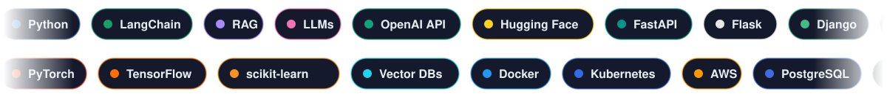
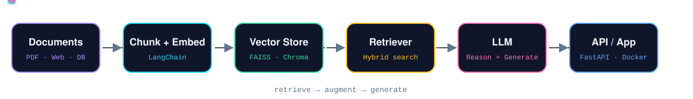

 

  

 

## ⚡ Tech Arsenal

 

## 🧠 How I Build GenAI Systems

<table>
<tr>
<td width="33%" valign="top">

**🤖 Generative AI**  
LLM apps, prompt engineering, RAG, AI agents and chatbots with LangChain.

</td>
<td width="33%" valign="top">

**📊 Data Science & ML**  
NLP, predictive modelling, feature engineering and end-to-end ML pipelines.

</td>
<td width="33%" valign="top">

**⚙️ Backend & Deploy**  
FastAPI, Flask and Django services, containerised and cloud-ready.

</td>
</tr>
</table>

### 🐍 Contribution Graph

<picture>
  <source media="(prefers-color-scheme: dark)" srcset="https://raw.githubusercontent.com/samarth3394/samarth3394/output/github-snake-dark.svg"/>
  <source media="(prefers-color-scheme: light)" srcset="https://raw.githubusercontent.com/samarth3394/samarth3394/output/github-snake.svg"/>
  
</picture>

## 🌱 Currently Exploring

| 🔭 Focus | 📌 What I'm digging into |
|:--|:--|
| **Agentic AI** | Multi-agent workflows, tool-calling LLMs |
| **Advanced RAG** | Hybrid search, re-ranking, evaluation pipelines |
| **LLMOps** | Monitoring, deployment and cost optimisation |
| **System Design** | Scalable architectures for AI products |

## 🤝 Let's Connect

Got an AI idea, a product to ship, or just want to talk tech?

  

<i>"The best way to predict the future is to build it."</i>

